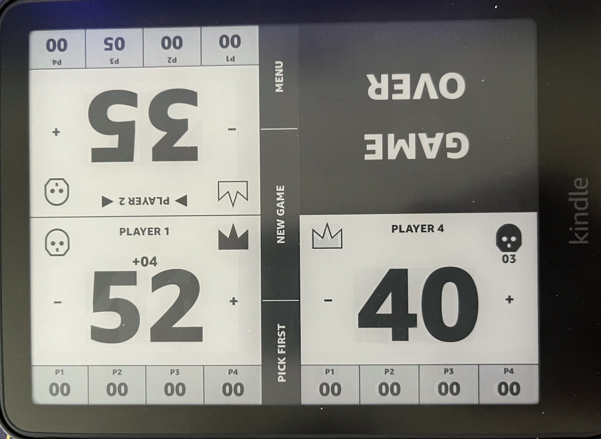

# V2.1 Kindle Device Acceptance

## Status

**Passed on 2026-07-27** using an Amazon Kindle Paperwhite.

This record covers the exact V2.1 production candidate after the inactivity-only
keep-awake integration. Device serial numbers, local paths, runtime save data, and logs
are intentionally excluded.

## Candidate identity

- Release archive: `mtg-life-counter-v2.1.0-kindle.zip`
- Archive SHA-256: `d17fbff3840aedabc4f90bd0a4430ae6ea2140cfbd442f7feabdd150111f1b76`
- ARM binary SHA-256: `e7a8fe63bf71206fd59aecb5821a6d9e8361adac16a7f0052dbfb800ac75bb5b`
- Payload: stripped 32-bit ARM EABI5 hard-float executable
- Archive entries: 6
- Runtime state and logs in archive: none

## Host verification

- Native game, layout, and device-adapter suites passed.
- All 3 menu/source/package contract tests passed.
- All 38 release, launcher lifecycle, installer, and packaging tests passed.
- Shell syntax, `git diff --check`, secret scan, and unsafe-execution scan passed.
- Independent native, launcher-lifecycle, release-contract, and final signal-race
  reviews passed with no remaining security or logic findings.
- The production binary contains `touchScreenSaverTimeout` and contains neither
  `preventScreenSaver` nor the removed idle-helper modes.

## Deployment verification

The transactional MTP installer preserved the existing `data/` subtree and reached
`INSTALL_COMPLETE`. It uploaded and readback-verified the production files before
cutover. An independent post-cutover MTP readback matched all four source payloads:

| File | Verified size |
|---|---:|
| `bin/launch.sh` | 5,593 bytes |
| `bin/mtg-life-counter` | 51,036 bytes |
| `config.xml` | 336 bytes |
| `menu.json` | 217 bytes |

The private keep-awake probe extension was absent after production deployment.

## Focused physical acceptance

| Check | Result |
|---|---|
| Launch the production app and leave it untouched for 12 minutes | Passed; app remained awake |
| Press the physical power button and leave it asleep for 90 seconds | Passed; Kindle remained asleep |
| Wake back into the app and change life with touch | Passed; wake and touch worked |
| Exit the app and leave the Kindle untouched for 12 minutes | Passed; ordinary auto-sleep returned |

## Release conclusion

The V2.1 production candidate satisfies the inactivity-only keep-awake contract:
active gameplay remains awake, physical-button sleep remains authoritative, wake/touch
behavior remains functional, and no keep-awake behavior survives normal app exit.
